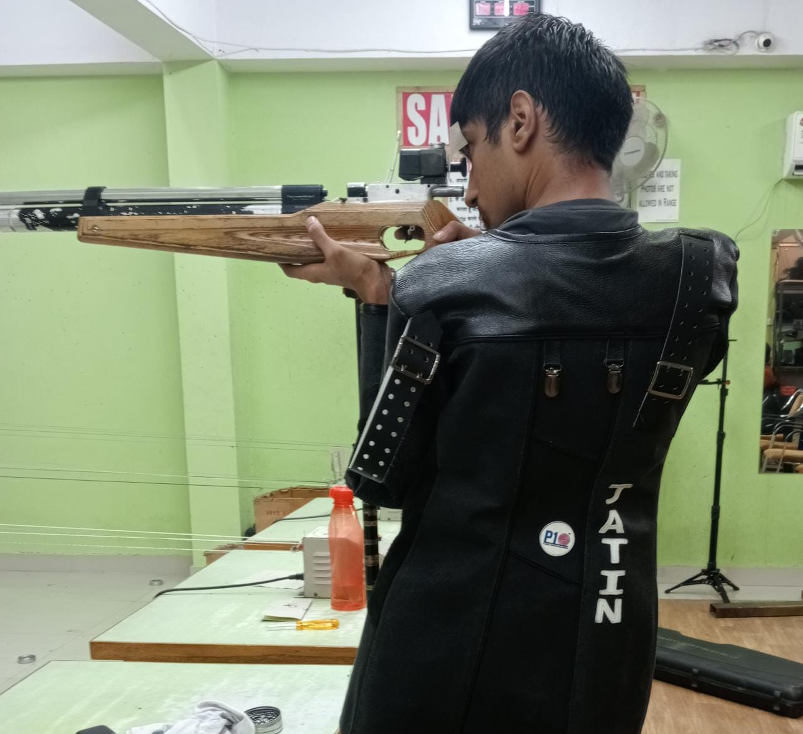

  

<h1 align="center">Jatin Sharma</h1>

  Control Systems Developer @ NCRA, India 
  Robotics • Embedded Systems • Control Engineering • Linux

  <a href="https://rootjatin.github.io"><strong>Portfolio</strong></a> •
  <a href="mailto:rootjatin@gmail.com"><strong>Email</strong></a> •
  <a href="https://gitlab.com/jatin.ska"><strong>GitLab</strong></a> •
  <a href="https://youtube.com/@rootjatin"><strong>YouTube</strong></a> •
  <a href="https://app.hackthebox.com/profile/113818"><strong>Hack The Box</strong></a>

---

## 👋 About Me

I am a control systems developer working across robotics, embedded systems, Linux, and hardware–software integration.

My work focuses on connecting sensing, control, actuation, telemetry, and debugging into reliable, complete systems.

I am also interested in astronomy, telescopes, space technology, and competitive shooting.

## 🎮 Interactive Portfolio

My portfolio is an interactive Mario-style game where visitors can explore my projects, experiments, and technical work.

  <a href="https://rootjatin.github.io"><strong>🎮 Explore my portfolio</strong></a>

## 🤖 Featured Project

### Humanoid Robot — Gyani 2.0

**Gyani 2.0** is a humanoid robotics platform focused on control systems, embedded firmware, and end-to-end hardware–software integration.

* Control-loop design and system tuning
* Embedded firmware for sensors and actuators
* Real-time sensing, control, and actuation
* Telemetry and debugging tools
* System testing and reliability improvements
* Complete sensing → control → actuation integration

 

## 🧰 Core Technologies

  Python • C • C++ • Embedded Systems • Linux • Control Systems • OpenGL • CI/CD

## 🌌 Beyond Engineering

<table>
  <tr>
    <td align="center" width="50%">
       
      <strong>Astronomy</strong> 
      Telescopes, space science, and space technology
    </td>
    <td align="center" width="50%">
       
      <strong>Competitive Shooting</strong> 
      10m Air Rifle and 50m 3-Position
    </td>
  </tr>
</table>

## 📺 YouTube

I share project updates, technical experiments, and other engineering-related content on YouTube.

  <a href="https://youtube.com/@rootjatin"><strong>▶ youtube.com/@rootjatin</strong></a>

## 📫 Contact

* **Email:** [rootjatin@gmail.com](mailto:rootjatin@gmail.com)
* **Portfolio:** [rootjatin.github.io](https://rootjatin.github.io)
* **GitLab:** [gitlab.com/jatin.ska](https://gitlab.com/jatin.ska)
* **YouTube:** [youtube.com/@rootjatin](https://youtube.com/@rootjatin)
* **Hack The Box:** [View profile](https://app.hackthebox.com/profile/113818)
